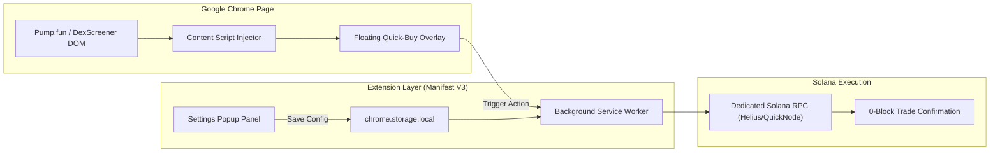

# ⚡ Pump.fun & DexScreener Pro Trading Terminal (Chrome Extension)

[](https://developer.chrome.com/docs/extensions/mv3/intro/)
[](https://solana.com)
[](https://developer.mozilla.org)
[](https://opensource.org/licenses/MIT)

> A high-performance browser extension (Manifest V3) that injects an **instant 1-click Quick-Buy overlay**, **real-time bonding curve migration progress bar**, and **developer wallet dumping alerts** directly onto `pump.fun` and `dexscreener.com` token charts.

---

### 💼 Need Custom Trading Extensions, UI Overlays, or Web3 Tooling?
I build high-frequency browser extensions, DEX trading terminals, and custom bot wrappers for retail traders, funds, and token launch communities.
* 💬 **Telegram:** [@JanzebBlockdev](https://t.me/JanzebBlockdev)
* 💼 **Upwork Profile:** [Upwork Verified Algorithmic Specialist](https://www.upwork.com/freelancers/~JanzebBlockdev)
* 📧 **Email:** `jahanzaibchanna70@gmail.com`

---

## 📑 Table of Contents
1. [Key Features](#-key-features)
2. [UI Architecture & Data Flow](#-ui-architecture--data-flow)
3. [Installation (Load Unpacked)](#-installation-load-unpacked)
4. [Customization & Presets](#-customization--presets)
5. [Disclaimer](#-disclaimer)

---

## 🚀 Key Features

* **Injected 1-Click Fast Buy Overlay:** Removes wallet confirmation lag by allowing direct execution with pre-configured SOL amounts (`0.2 SOL`, `0.5 SOL`, `1.0 SOL`).
* **Live Bonding Curve Meter:** Displays real-time progress percentage toward the 100% Raydium pool migration threshold without having to reload the page.
* **Dev Wallet Dumping Sentinel:** In-page warning banner that detects if the token deployer wallet sells tokens from their initial allocation.
* **Configurable Slippage & Priority Fees:** Custom high-speed RPC connection and priority tip settings saved locally in `chrome.storage`.
* **Zero Dependency Manifest V3:** Pure vanilla web components for ultra-lightweight performance and zero page load slowdown.

---

## 🏛️ UI Architecture & Data Flow



---

## 🛠️ Installation (Load Unpacked in Chrome)

You can load and run this extension locally in under 30 seconds:

1. Clone or download this repository:
   ```bash
   git clone https://github.com/jahanzaib-codes/pumpfun-trading-terminal-extension.git
   ```
2. Open Google Chrome and navigate to:
   ```text
   chrome://extensions/
   ```
3. Enable **Developer mode** via the toggle switch in the top right corner.
4. Click the **"Load unpacked"** button in the top left corner.
5. Select the `pumpfun-trading-terminal-extension` folder.
6. Navigate to any token page on [pump.fun](https://pump.fun) or [dexscreener.com](https://dexscreener.com) to view the terminal overlay!

---

## ⚙️ Customization & Presets

Click the extension icon in your Chrome toolbar to open the dark-mode configuration popup:
* **Custom Solana RPC:** Connect your private Helius, QuickNode, or Triton RPC endpoint for maximum execution speed.
* **Slippage Tolerance:** Default set to 5%, customizable from 1% to 50%.
* **Priority Tip:** Jito or compute unit priority fee to ensure prompt block inclusion during volatile market surges.
* **Quick Buy Presets:** Change the default button values to match your personal trade sizing (e.g., `0.5`, `1.0`, `2.5`).

---

## ⚠️ Disclaimer

*This extension is an open-source research and productivity tool. Always ensure your private keys and RPC endpoints are handled securely. The developers assume no liability for trading outcomes.*

---
*Maintained by **Jahanzaib** ([@jahanzaib-codes](https://github.com/jahanzaib-codes))*

